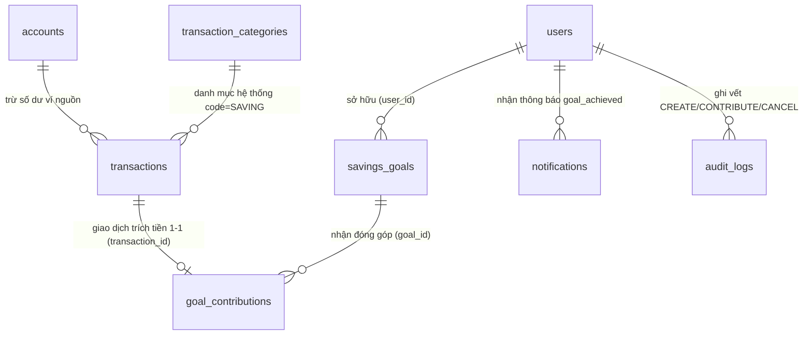
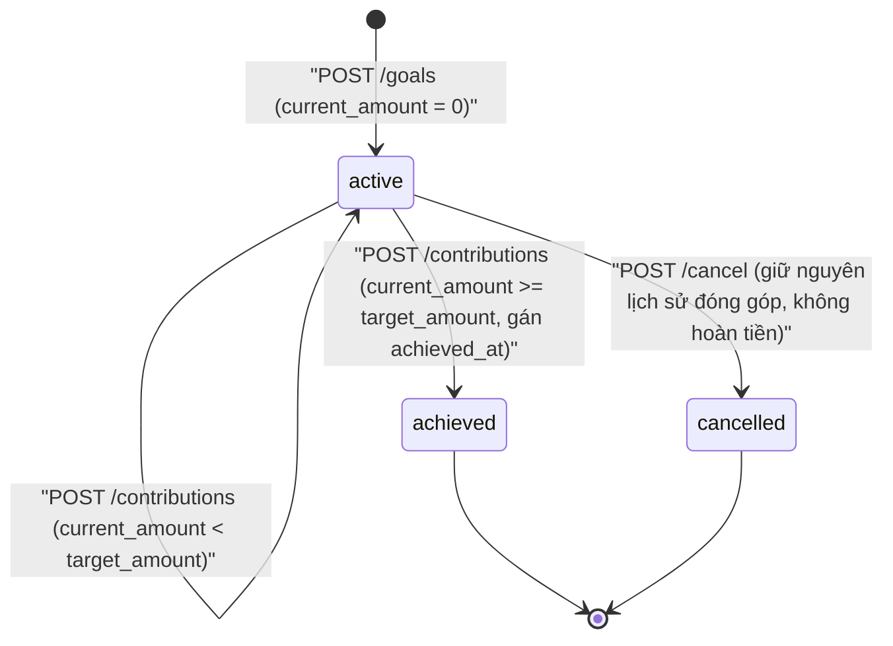
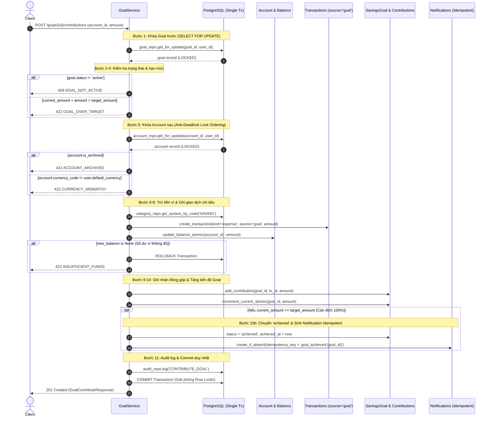

# TÀI LIỆU YÊU CẦU KỸ THUẬT API ENDPOINTS (API_ENDPOINT.MD)

Tài liệu này tổng hợp chi tiết các đặc tả kỹ thuật, giao thức kết nối, định dạng dữ liệu, ràng buộc và luồng nghiệp vụ của hệ thống **Personal Finance API**. 

Tài liệu được phân loại theo cấu trúc mô-đun hóa để phục vụ việc mở rộng và tích hợp các module nghiệp vụ trong tương lai.

---

## MỤC LỤC TỔNG QUAN HỆ THỐNG

- [A. THÔNG TIN MÔI TRƯỜNG & TÀI LIỆU TRỰC QUAN (SWAGGER UI)](#a-thông-tin-môi-trường--tài-liệu-trực-quan-swagger-ui)
- [B. CẤU TRÚC DANH MỤC CÁC MODULE HỆ THỐNG](#b-cấu-trúc-danh-mục-các-module-hệ-thống)
- [1. MODULE AUTHENTICATION & USER IDENTITY (DANH MỤC SỐ 1)](#1-module-authentication--user-identity-danh-mục-số-1)
  - [1.1. Đăng ký tài khoản (User Registration)](#11-đăng-ký-tài-khoản-user-registration)
  - [1.2. Đăng nhập hệ thống (User Login)](#12-đăng-nhập-hệ-thống-user-login)
  - [1.3. Làm mới Access Token (Token Refresh & Rotation)](#13-làm-mới-access-token-token-refresh--rotation)
  - [1.4. Đăng xuất (User Logout & Session Revocation)](#14-đăng-xuất-user-logout--session-revocation)
  - [1.5. Quên mật khẩu & Đặt lại mật khẩu (Forgot & Reset Password)](#15-quên-mật-khẩu--đặt-lại-mật-khẩu-forgot--reset-password)
  - [1.6. Đổi mật khẩu chủ động (Change Password)](#16-đổi-mật-khẩu-chủ-động-change-password)
  - [1.7. Tổng hợp các tính năng bảo mật (Security Features & Best Practices)](#17-tổng-hợp-các-tính-năng-bảo-mật-security-features--best-practices)
- [2. MODULE D: GIAO DỊCH, DANH MỤC, CHUYỂN TIỀN & ĐÍNH KÈM (DANH MỤC SỐ 4)](#2-module-d-giao-dịch-danh-mục-chuyển-tiền--đính-kèm-danh-mục-số-4)
  - [2.1. Quản lý Danh mục & Danh mục con (Categories & Subcategories)](#21-quản-lý-danh-mục--danh-mục-con-categories--subcategories)
  - [2.2. Quản lý Giao dịch Thu / Chi (Transactions)](#22-quản-lý-giao-dịch-thu--chi-transactions)
  - [2.3. Chuyển tiền giữa các tài khoản (Transfers)](#23-chuyển-tiền-giữa-các-tài-khoản-transfers)
  - [2.4. Quản lý Nhãn phân loại (Tags)](#24-quản-lý-nhãn-phân-loại-tags)
  - [2.5. Tệp đính kèm hóa đơn (Transaction Attachments)](#25-tệp-đính-kèm-hóa-đơn-transaction-attachments)
- [3. MODULE E: IMPORT SAO KÊ 2 PHA (DANH MỤC SỐ 5)](#3-module-e-import-sao-kê-2-pha-danh-mục-số-5)
  - [3.1. Tải file sao kê để xem trước (Preview / Staging)](#31-tải-file-sao-kê-để-xem-trước-preview--staging)
  - [3.2. Danh sách & Chi tiết lô Import](#32-danh-sách--chi-tiết-lô-import)
  - [3.3. Xác nhận ghi sổ giao dịch (Confirm / Finalize)](#33-xác-nhận-ghi-sổ-giao-dịch-confirm--finalize)
  - [3.4. Hủy lô nháp (Cancel Batch)](#34-hủy-lô-nháp-cancel-batch)
- [4. MODULE F: NGÂN SÁCH & CẢNH BÁO CHI TIÊU (DANH MỤC SỐ 6)](#4-module-f-ngân-sách--cảnh-báo-chi-tiêu-danh-mục-số-6)
  - [4.1. Quản lý Kỳ ngân sách (Budgets)](#41-quản-lý-kỳ-ngân-sách-budgets)
  - [4.2. Phân bổ Hạn mức Danh mục (Budget Categories)](#42-phân-bổ-hạn-mức-danh-mục-budget-categories)
  - [4.3. Tính toán Tiến độ Chi tiêu Thực tế (Budget Progress)](#43-tính-toán-tiến-độ-chi-tiêu-thực-tế-budget-progress)
  - [4.4. Cảnh báo Ngưỡng & DB Idempotency (Alert Events)](#44-cảnh-báo-ngưỡng--db-idempotency-alert-events)
- [5. MODULE H: MỤC TIÊU TIẾT KIỆM (SAVINGS GOALS & CONTRIBUTIONS)](#5-module-h-mục-tiêu-tiết-kiệm-savings-goals--contributions)
  - [5.1. Tạo mục tiêu tiết kiệm mới (Create Goal)](#51-tạo-mục-tiêu-tiết-kiệm-mới-create-goal)
  - [5.2. Danh sách mục tiêu tiết kiệm (List Goals)](#52-danh-sách-mục-tiêu-tiết-kiệm-list-goals)
  - [5.3. Chi tiết mục tiêu & Lịch sử đóng góp (Get Goal Detail)](#53-chi-tiết-mục-tiêu--lịch-sử-đóng-góp-get-goal-detail)
  - [5.4. Cập nhật mục tiêu tiết kiệm (Update Goal)](#54-cập-nhật-mục-tiêu-tiết-kiệm-update-goal)
  - [5.5. Hủy mục tiêu tiết kiệm (Cancel Goal)](#55-hủy-mục-tiêu-tiết-kiệm-cancel-goal)
  - [5.6. Góp tiền vào mục tiêu tiết kiệm (Contribute — Core Workflow W11)](#56-góp-tiền-vào-mục-tiêu-tiết-kiệm-contribute--core-workflow-w11)
  - [5.7. Quy tắc Khóa giao dịch nguồn trích quỹ (Source Locking Rules)](#57-quy-tắc-khóa-giao-dịch-nguồn-trích-quỹ-source-locking-rules)
  - [5.8. Xử lý tranh chấp đa luồng & Tính Idempotent (Concurrency & Idempotency)](#58-xử-lý-tranh-chấp-đa-luồng--tính-idempotent-concurrency--idempotency)

---

## A. THÔNG TIN MÔI TRƯỜNG & TÀI LIỆU TRỰC QUAN (SWAGGER UI)

Hệ thống được phát triển trên nền tảng **FastAPI**, tự động cung cấp bộ tài liệu tương tác chuẩn OpenAPI:

| Thành phần | Đường dẫn (URL / Path) | Ghi chú |
| :--- | :--- | :--- |
| **Server Host mặc định** | `http://localhost:8000` | Cổng phát triển tiêu chuẩn |
| **API Version Prefix** | `/api/v1` | Tiền tố cho toàn bộ API phiên bản 1 |
| **Base API URL** | `http://localhost:8000/api/v1` | URL gốc cho các endpoint nghiệp vụ |
| **Swagger UI Documentation** | `http://localhost:8000/docs` | Giao diện kiểm thử trực quan tương tác (Interactive API Docs) |
| **ReDoc Documentation** | `http://localhost:8000/redoc` | Tài liệu tĩnh theo cấu trúc phân cấp chuẩn kỹ thuật |
| **OpenAPI Schema (JSON)** | `http://localhost:8000/openapi.json` | Đặc tả schema chuẩn OpenAPI 3.1.0 |
| **Health Check Endpoint** | `http://localhost:8000/health` | Kiểm tra tình trạng hoạt động của service |

### Quy ước chung về truyền tải dữ liệu
- **Content-Type**: Toàn bộ request/response body sử dụng định dạng JSON `application/json; charset=utf-8`.
- **Cơ chế xác thực (Authentication)**: Các endpoint yêu cầu quyền đăng nhập sử dụng chuẩn HTTP Bearer Token qua header:
  ```http
  Authorization: Bearer <access_token>
  ```
- **Quy chuẩn mã hóa thời gian**: Chuỗi thời gian chuẩn ISO 8601 kèm múi giờ UTC (ví dụ: `2026-10-18T10:30:00Z`).

---

## B. CẤU TRÚC DANH MỤC CÁC MODULE HỆ THỐNG

Hệ thống được tổ chức thành các mô-đun độc lập, định hướng tích hợp dài hạn:
- **1. Module Authentication & User Identity**: Xác thực, phân quyền, cấp phát và thu hồi phiên JWT.
- **2. Module D: Giao dịch, Danh mục, Chuyển tiền & Đính kèm**: Quản lý thu/chi thực tế, cây danh mục, chuyển tiền đa tài khoản và hóa đơn.
- **3. Module E: Import sao kê 2 pha**: Tải file sao kê tạm (Staging), đối soát số dư và ghi sổ chính thức.
- **4. Module F: Ngân sách & Cảnh báo chi tiêu**: Quản lý hạn mức chi tiêu định kỳ, cảnh báo đa ngưỡng và bảo vệ chống trùng lặp.
- **5. Module H: Mục tiêu tiết kiệm (Savings Goals & Contributions)**: Quản lý kế hoạch tích lũy tài chính, theo dõi tiến độ F7, và thực hiện luồng cốt lõi W11 trích quỹ nguyên tử đa bảng.
---

# 1. MODULE AUTHENTICATION & USER IDENTITY (DANH MỤC SỐ 1)

Module Authentication đảm nhiệm việc quản lý định danh người dùng, kiểm soát truy cập và bảo vệ phiên làm việc qua cơ chế **Dual Token (Access Token + Refresh Token Rotation)**.

---

### 1.1. ĐĂNG KÝ TÀI KHOẢN (USER REGISTRATION)

Đăng ký tài khoản người dùng mới vào hệ thống, thiết lập vai trò cơ bản (`user`) và tự động khởi tạo phiên đăng nhập đầu tiên.

- **API Endpoint**: `POST /api/v1/auth/register`
- **Full URL**: `http://localhost:8000/api/v1/auth/register`
- **Authentication**: `None (Public)`
- **HTTP Method**: `POST`
- **Request Headers**:
  - `Content-Type: application/json`

#### Request Body & Constraints
| Trường | Kiểu dữ liệu | Bắt buộc | Ràng buộc kỹ thuật (Validation) | Mô tả chi tiết |
| :--- | :--- | :---: | :--- | :--- |
| `email` | `string (email)` | Có | Chuẩn Email RFC, tự động chuẩn hóa chữ thường (`lowercase`) và cắt khoảng trắng | Email dùng để đăng nhập và định danh duy nhất |
| `username` | `string` | Có | Độ dài từ 3 đến 50 ký tự, regex: `^[A-Za-z0-9_.-]+$` | Tên người dùng định danh duy nhất trong hệ thống |
| `password` | `string` | Có | Độ dài ký tự: 8 - 72 ký tự, độ dài byte UTF-8 $\le$ 72 bytes | Mật khẩu thô (giới hạn 72 bytes do thuật toán Bcrypt) |
| `full_name` | `string` | Không | Tối đa 150 ký tự, tự động cắt khoảng trắng thừa | Họ và tên đầy đủ hiển thị của người dùng |
| `default_currency`| `string` | Không | Mặc định: `"VND"`. Độ dài đúng 3 ký tự (ISO 4217), phải tồn tại trong bảng `currencies` | Mã tiền tệ mặc định cho ví và báo cáo tài chính |

#### Request Body Example
```json
{
  "email": "user@example.com",
  "username": "financial_user",
  "password": "StrongPassword123@",
  "full_name": "Nguyễn Văn A",
  "default_currency": "VND"
}
```

#### Business Flow (Luồng xử lý nghiệp vụ)
1. **Validation**: Kiểm tra cấu trúc dữ liệu theo schema `UserCreate`.
2. **Kiểm tra tiền tệ**: `CurrencyRepository` xác thực mã `default_currency` có tồn tại trong hệ thống hay không. Nếu không, trả về lỗi `422`.
3. **Kiểm tra vai trò mặc định**: `UserRepository` tìm role có mã `user`. Nếu thiếu, báo lỗi hệ thống `500`.
4. **Mã hóa mật khẩu**: Băm mật khẩu bằng thuật toán **Bcrypt** với salt ngẫu nhiên.
5. **Khởi tạo dữ liệu người dùng**: Lưu người dùng mới vào database với trạng thái mặc định `status = "active"`.
6. **Gán vai trò**: Gán quan hệ vai trò người dùng vào bảng `user_roles`.
7. **Khởi tạo phiên làm việc (Session)**:
   - Tạo mã phiên `session_id` ngẫu nhiên chuẩn UUID v4.
   - Thu thập thông tin client: IP Address (nếu hợp lệ) và User-Agent header (tối đa 255 ký tự).
   - Thiết lập thời gian hết hạn của phiên: `now() + 30 ngày`.
   - Sinh chuỗi `refresh_token` (JWT chứa `sub`, `sid`, `jti`).
   - Băm chuỗi refresh token bằng **SHA-256** và lưu vào bảng `user_sessions`.
   - Sinh chuỗi `access_token` (JWT chứa `sub`, danh sách `roles`, thời hạn 15 phút).
8. **Transaction Commit**: Thực thi commit vào database và trả về cặp token cho client.

#### Response Specifications
- **Success Response (`201 Created`)**:
  ```json
  {
    "access_token": "eyJhbGciOiJIUzI1NiIsInR5cCI6IkpXVCJ9...",
    "refresh_token": "eyJhbGciOiJIUzI1NiIsInR5cCI6IkpXVCJ9...",
    "token_type": "bearer"
  }
  ```
- **Error Responses**:
  - `409 Conflict`: Email hoặc username đã được đăng ký trước đó.
    ```json
    {
      "detail": "Email or username is already registered"
    }
    ```
  - `422 Unprocessable Entity`: Dữ liệu không thỏa mãn validation (mật khẩu quá ngắn, quá 72 bytes, định dạng email sai, hoặc đơn vị tiền tệ không hỗ trợ).
    ```json
    {
      "detail": "Unsupported default currency"
    }
    ```

---

### 1.2. ĐĂNG NHẬP HỆ THỐNG (USER LOGIN)

Xác thực thông tin tài khoản và cấp phát cặp token mới để client truy cập các tài nguyên bảo vệ.

- **API Endpoint**: `POST /api/v1/auth/login`
- **Full URL**: `http://localhost:8000/api/v1/auth/login`
- **Authentication**: `None (Public)`
- **HTTP Method**: `POST`
- **Request Headers**:
  - `Content-Type: application/json`

#### Request Body & Constraints
| Trường | Kiểu dữ liệu | Bắt buộc | Ràng buộc kỹ thuật | Mô tả chi tiết |
| :--- | :--- | :---: | :--- | :--- |
| `email` | `string (email)` | Có | Chuẩn Email RFC, tự động chuẩn hóa chữ thường | Địa chỉ email đăng ký |
| `password` | `string` | Có | Tối thiểu 1 ký tự, tối đa 72 ký tự | Mật khẩu tài khoản |

#### Request Body Example
```json
{
  "email": "user@example.com",
  "password": "StrongPassword123@"
}
```

#### Business Flow (Luồng xử lý nghiệp vụ)
1. **Tìm kiếm người dùng**: Truy vấn `UserRepository` theo email (chuẩn hóa chữ thường) đồng thời tải sẵn danh sách quyền (`selectinload(User.roles)`).
2. **Xác thực mật khẩu**: So khớp mật khẩu thô và hash lưu trong database thông qua hàm `bcrypt.checkpw`.
3. **Kiểm tra trạng thái tài khoản**: Kiểm tra trường `status`:
   - Nếu `user is None` hoặc sai mật khẩu: Trả về lỗi `401 Unauthorized` với thông điệp chung `"Invalid email or password"` để chống tấn công dò tài khoản.
   - Nếu `status != "active"` (tài khoản bị khóa): Trả về lỗi `401 Unauthorized` kèm thông báo `"Account is locked"`.
4. **Cập nhật thời gian đăng nhập**: Cập nhật `last_login_at = now()` vào bảng `users`.
5. **Cấp phát phiên (Session Creation)**:
   - Sinh UUID phiên mới, ghi nhận IP Address và User-Agent.
   - Băm SHA-256 chuỗi refresh token và lưu vào `user_sessions`.
   - Sinh access token mang claim quyền hạn của người dùng.
6. **Transaction Commit**: Lưu phiên và trả về `TokenPair`.

#### Response Specifications
- **Success Response (`200 OK`)**:
  ```json
  {
    "access_token": "eyJhbGciOiJIUzI1NiIsInR5cCI6IkpXVCJ9...",
    "refresh_token": "eyJhbGciOiJIUzI1NiIsInR5cCI6IkpXVCJ9...",
    "token_type": "bearer"
  }
  ```
- **Error Responses**:
  - `401 Unauthorized`: Sai email hoặc mật khẩu, hoặc tài khoản đang bị khóa.
    ```json
    {
      "detail": "Invalid email or password"
    }
    ```
  - `422 Unprocessable Entity`: Định dạng body hoặc email không hợp lệ.

---

### 1.3. LÀM MỚI ACCESS TOKEN (TOKEN REFRESH & ROTATION)

Cấp phát lại Access Token mới khi token cũ đã hết hạn, đồng thời áp dụng cơ chế **Refresh Token Rotation** (thu hồi refresh token cũ và cấp refresh token mới) nhằm chống tấn công Replay Attack.

- **API Endpoint**: `POST /api/v1/auth/refresh`
- **Full URL**: `http://localhost:8000/api/v1/auth/refresh`
- **Authentication**: `None` (Sử dụng Refresh Token truyền trong Body)
- **HTTP Method**: `POST`
- **Request Headers**:
  - `Content-Type: application/json`

#### Request Body & Constraints
| Trường | Kiểu dữ liệu | Bắt buộc | Ràng buộc kỹ thuật | Mô tả chi tiết |
| :--- | :--- | :---: | :--- | :--- |
| `refresh_token` | `string` | Có | Độ dài từ 1 đến 4096 ký tự | Chuỗi Refresh Token JWT còn hiệu lực |

#### Request Body Example
```json
{
  "refresh_token": "eyJhbGciOiJIUzI1NiIsInR5cCI6IkpXVCJ9..."
}
```

#### Business Flow (Luồng xử lý nghiệp vụ)
1. **Giải mã Token**:
   - Giải mã JWT bằng Secret Key và Algorithm của hệ thống.
   - Xác minh claim `type == "refresh"`.
   - Trích xuất định danh người dùng `sub` (User ID) và định danh phiên `sid` (Session ID).
2. **Khóa bản ghi phiên (Row-level Lock)**:
   - Truy vấn phiên qua `UserSessionRepository` bằng câu lệnh `SELECT ... FOR UPDATE`.
   - Cơ chế khóa hàng ngăn chặn trường hợp hai request refresh token được gửi song song đồng thời từ cùng một client (Race Condition).
3. **Kiểm tra tính hợp lệ của phiên**:
   - Phiên có tồn tại trong database hay không.
   - Phiên có đúng là của `user_id` trong token hay không.
   - Phiên đã bị thu hồi trước đó chưa (`revoked_at IS NULL`).
   - Phiên đã hết hạn chưa (`expires_at > now()`).
   - So sánh hash SHA-256 của refresh token với giá trị lưu trong database bằng phương thức an toàn `hmac.compare_digest` (chống Timing Attack).
   - Nếu vi phạm bất kỳ điều kiện nào $\rightarrow$ Trả về `401 Unauthorized` ngay lập tức.
4. **Kiểm tra trạng thái tài khoản**: Kiểm tra người dùng có còn tồn tại và ở trạng thái `active` hay không.
5. **Thực hiện Token Rotation**:
   - Tạo chuỗi `refresh_token` mới kế thừa thời hạn hết hạn (`expires_at`) của phiên hiện tại.
   - Cập nhật trường `refresh_token_hash` của session thành hash mới.
   - Tạo chuỗi `access_token` mới (15 phút) chứa danh sách roles cập nhật nhất của user.
6. **Commit & Return**: Lưu thay đổi và trả về `TokenPair` mới.

#### Response Specifications
- **Success Response (`200 OK`)**:
  ```json
  {
    "access_token": "eyJhbGciOiJIUzI1NiIsInR5cCI6IkpXVCJ9...",
    "refresh_token": "eyJhbGciOiJIUzI1NiIsInR5cCI6IkpXVCJ9...",
    "token_type": "bearer"
  }
  ```
- **Error Responses**:
  - `401 Unauthorized`: Token không hợp lệ, phiên đã hết hạn, hoặc bị thu hồi.
    ```json
    {
      "detail": "Invalid or expired refresh token"
    }
    ```

---

### 1.4. ĐĂNG XUẤT (USER LOGOUT & SESSION REVOCATION)

Vô hiệu hóa phiên đăng nhập hiện tại trên thiết bị bằng cách đánh dấu thời điểm thu hồi của phiên trong cơ sở dữ liệu.

- **API Endpoint**: `POST /api/v1/auth/logout`
- **Full URL**: `http://localhost:8000/api/v1/auth/logout`
- **Authentication**: `None` (Truyền Refresh Token trong Request Body)
- **HTTP Method**: `POST`
- **Request Headers**:
  - `Content-Type: application/json`

#### Request Body & Constraints
| Trường | Kiểu dữ liệu | Bắt buộc | Ràng buộc kỹ thuật | Mô tả chi tiết |
| :--- | :--- | :---: | :--- | :--- |
| `refresh_token` | `string` | Có | Độ dài từ 1 đến 4096 ký tự | Refresh Token của phiên cần đăng xuất |

#### Request Body Example
```json
{
  "refresh_token": "eyJhbGciOiJIUzI1NiIsInR5cCI6IkpXVCJ9..."
}
```

#### Business Flow (Luồng xử lý nghiệp vụ)
1. **Giải mã Token**: Giải mã chuỗi JWT, xác thực `type == "refresh"`, trích xuất `sid` và `sub`.
2. **Khóa bản ghi phiên**: Truy vấn session theo `sid` có `with_for_update()`.
3. **Đối soát tính toàn vẹn**: So sánh hash token và kiểm tra quyền sở hữu của user.
4. **Vô hiệu hóa phiên**:
   - Đặt `revoked_at = now()`.
   - Kể từ thời điểm này, refresh token đó không thể sử dụng để làm mới access token được nữa.
5. **Commit**: Lưu vào database và trả về mã trạng thái thành công.

#### Response Specifications
- **Success Response (`204 No Content`)**: Không có response body.
- **Error Responses**:
  - `401 Unauthorized`: Token không hợp lệ hoặc không tìm thấy phiên tương ứng.
    ```json
    {
      "detail": "Invalid refresh token"
    }
    ```

---

### 1.5. QUÊN MẬT KHẨU & ĐẶT LẠI MẬT KHẨU (FORGOT & RESET PASSWORD)

Quy trình hỗ trợ người dùng tự lấy lại quyền truy cập tài khoản khi quên mật khẩu qua email xác nhận gồm hai giai đoạn:

```
[Client] ---> (1) Gửi yêu cầu qua Email ---> [API: forgot-password]
                                                    |
                                            Tạo Reset Token (30m)
                                            & Gửi Email liên kết
                                                    |
[Client] <--- (2) Gửi Token + Pass mới <--- [Người dùng bấm link]
       |
  [API: reset-password] ---> Băm mật khẩu mới & Hủy toàn bộ Sessions cũ
```

#### Bước 1: Yêu cầu cấp lại mật khẩu (Forgot Password Request)
- **API Endpoint**: `POST /api/v1/auth/forgot-password`
- **Full URL**: `http://localhost:8000/api/v1/auth/forgot-password`
- **Authentication**: `None (Public)`
- **Request Body**:
  ```json
  {
    "email": "user@example.com"
  }
  ```
- **Business Flow**:
  1. Kiểm tra định dạng email hợp lệ.
  2. Truy vấn người dùng trong database theo email.
  3. **Chống dò quét thông tin người dùng (Anti-Email Enumeration)**: Dù email có tồn tại hay không trong hệ thống, API **luôn trả về cùng một thông điệp phản hồi thành công** (`200 OK`).
  4. Nếu người dùng tồn tại và đang `active`:
     - Tạo một JWT Token loại `type = "password_reset"` với thời hạn là 30 phút (`settings.password_reset_token_expire_minutes`).
     - Gửi email chứa đường dẫn đặt lại mật khẩu dạng: `https://frontend-domain.com/reset-password?token=<reset_token>`.
- **Success Response (`200 OK`)**:
  ```json
  {
    "message": "If the email is registered, a password reset link has been sent."
  }
  ```

---

#### Bước 2: Xác nhận đặt lại mật khẩu mới (Reset Password Confirmation)
- **API Endpoint**: `POST /api/v1/auth/reset-password`
- **Full URL**: `http://localhost:8000/api/v1/auth/reset-password`
- **Authentication**: `None` (Xác thực qua mã Reset Token trong Body)
- **Request Body**:
  ```json
  {
    "token": "eyJhbGciOiJIUzI1NiIsInR5cCI6IkpXVCJ9...",
    "new_password": "NewStrongPassword456@"
  }
  ```
- **Constraints**:
  - `token`: Chuỗi JWT hợp lệ, chưa hết hạn (trong vòng 30 phút).
  - `new_password`: Từ 8 đến 72 ký tự (tối đa 72 UTF-8 bytes).
- **Business Flow**:
  1. Giải mã `token` và kiểm tra `payload["type"] == "password_reset"`. Nếu hết hạn hoặc sai kiểu, trả về `400 Bad Request`.
  2. Trích xuất `user_id = UUID(payload["sub"])`.
  3. Lấy thông tin người dùng và xác nhận trạng thái `active`.
  4. Mã hóa `new_password` bằng Bcrypt và cập nhật `password_hash`.
  5. **Bảo mật phiên**: Gọi `session_repo.revoke_all_by_user_id(user_id)` để **thu hồi toàn bộ các phiên đăng nhập hiện có** trên mọi thiết bị, buộc kẻ xâm nhập hoặc các phiên cũ phải đăng nhập lại bằng mật khẩu mới.
  6. Commit transaction và trả về thông báo thành công.
- **Success Response (`200 OK`)**:
  ```json
  {
    "message": "Password has been reset successfully. Please login with your new password."
  }
  ```
- **Error Responses**:
  - `400 Bad Request`: Token đặt lại mật khẩu không hợp lệ hoặc đã hết hạn.
    ```json
    {
      "detail": "Invalid or expired password reset token"
    }
    ```
  - `422 Unprocessable Entity`: Mật khẩu mới không thỏa mãn điều kiện độ dài/định dạng.

---

### 1.6. ĐỔI MẬT KHẨU CHỦ ĐỘNG (CHANGE PASSWORD)

Cho phép người dùng đã đăng nhập tự đổi mật khẩu tài khoản trong trang cài đặt cá nhân.

- **API Endpoint**: `PUT /api/v1/users/me/password`
- **Full URL**: `http://localhost:8000/api/v1/users/me/password`
- **Authentication**: `Bearer Token (JWT Access Token Required)`
- **HTTP Method**: `PUT`
- **Request Headers**:
  - `Authorization: Bearer <access_token>`
  - `Content-Type: application/json`

#### Request Body & Constraints
| Trường | Kiểu dữ liệu | Bắt buộc | Ràng buộc kỹ thuật | Mô tả chi tiết |
| :--- | :--- | :---: | :--- | :--- |
| `old_password` | `string` | Có | 1 đến 72 ký tự | Mật khẩu hiện tại của người dùng |
| `new_password` | `string` | Có | 8 đến 72 ký tự, tối đa 72 bytes UTF-8 | Mật khẩu mới cần thiết lập |

#### Request Body Example
```json
{
  "old_password": "StrongPassword123@",
  "new_password": "NewStrongPassword456@"
}
```

#### Business Flow (Luồng xử lý nghiệp vụ)
1. **Dependency Injection**: Tầng API trích xuất thông tin người dùng từ `CurrentUser` dependency (`get_current_user`).
2. **Xác thực mật khẩu cũ**: Kiểm tra `old_password` với `user.password_hash` bằng `verify_password`. Nếu sai, ném ngoại lệ `InvalidPasswordError`.
3. **Mã hóa và cập nhật**:
   - Băm `new_password` bằng thuật toán Bcrypt.
   - Gán `user.password_hash = hash_password(new_password)`.
   - `user_repo.update(user)`.
4. **Quản lý phiên**: Có thể tùy chọn giữ phiên hiện tại hoặc thu hồi các phiên làm việc khác để tăng cường tính an toàn.
5. **Commit**: Thực thi lưu vào database và trả về mã thành công `204 No Content`.

#### Response Specifications
- **Success Response (`204 No Content`)**: Không có response body.
- **Error Responses**:
  - `400 Bad Request`: Mật khẩu cũ không chính xác.
    ```json
    {
      "detail": "Current password is not correct"
    }
    ```
  - `401 Unauthorized`: Access Token bị thiếu, sai hoặc đã hết hạn.
    ```json
    {
      "detail": "Not authenticated"
    }
    ```
  - `422 Unprocessable Entity`: Mật khẩu mới không thỏa mãn độ dài (dưới 8 ký tự hoặc vượt quá 72 UTF-8 bytes).

---

### 1.7. TỔNG HỢP CÁC TÍNH NĂNG BẢO MẬT (SECURITY FEATURES & BEST PRACTICES)

1. **Giới hạn 72 Bytes của thuật toán Bcrypt**:
   - Thuật toán băm Bcrypt chỉ xử lý tối đa 72 bytes đầu tiên của mật khẩu thô.
   - Hệ thống áp dụng validator kiểm tra rõ ràng `len(password.encode('utf-8')) <= 72` ngay tại tầng Schema Pydantic để ngăn chặn lỗi Silent Truncation (cắt xén âm thầm ký tự thừa gây hiểu lầm cho người dùng) và phòng chống tấn công từ chối dịch vụ (DoS) bằng payload mật khẩu siêu dài.
2. **Refresh Token Rotation (RTR)**:
   - Mỗi chu kỳ gọi `/auth/refresh` thành công sẽ hủy hoàn toàn refresh token cũ và sinh một refresh token mới. Nếu một refresh token đã dùng bị gửi lại, hệ thống có thể phát hiện và phong tỏa phiên làm việc ngay lập tức.
3. **Chống Race Condition bằng Khóa hàng (Row-level Locking)**:
   - Thao tác refresh token và revoke sử dụng `with_for_update()` của PostgreSQL, đảm bảo các request đồng thời từ cùng một thiết bị không thể lạm dụng sinh nhiều phiên hợp lệ cùng lúc.
4. **Chống tấn công đo thời gian (Timing-Attack Protection)**:
   - Việc so sánh hash chuỗi token trong database được thực hiện bằng `hmac.compare_digest`, ngăn chặn kẻ tấn công đo thời gian phản hồi của CPU để suy đoán nội dung token.
5. **Bảo mật lưu trữ Token (One-way Hashing)**:
   - Refresh token của người dùng **không bao giờ được lưu dưới dạng chuỗi thô** trong cơ sở dữ liệu. Chỉ có chuỗi băm **SHA-256** được lưu trữ trong bảng `user_sessions`. Khi database bị rò rỉ, kẻ tấn công không thể sử dụng trực tiếp các hash này để truy cập API.
6. **Theo dõi và Giám sát phiên (Session Forensics)**:
   - Mỗi phiên lưu trữ đầy đủ `ip_address`, `user_agent`, `created_at`, `expires_at`, và `revoked_at` để phục vụ đối soát, thống kê đăng nhập bất thường và cho phép người dùng kiểm tra lịch sử thiết bị.
7. **Thời hạn tồn tại ngắn của Access Token (Short-lived Tokens)**:
   - Access token chỉ có hiệu lực trong **15 phút**. Kể cả khi access token bị lộ qua đường truyền mạng, thiệt hại được giới hạn trong khoảng thời gian rất ngắn.
8. **Chống dò quét tài khoản (Anti-User Enumeration)**:
   - Endpoint quên mật khẩu luôn phản hồi thành công một thông điệp thống nhất để ngăn chặn kẻ tấn công lợi dụng phản hồi nhằm lập danh sách email có trong hệ thống.


---

# 2. MODULE D: GIAO DỊCH, DANH MỤC, CHUYỂN TIỀN & ĐÍNH KÈM (DANH MỤC SỐ 4)

Module D đảm nhiệm việc quản lý thu / chi thực tế, hệ thống danh mục phân cấp, luồng chuyển tiền đa tài khoản và tệp đính kèm hóa đơn.

---

### 2.1. QUẢN LÝ DANH MỤC & DANH MỤC CON (CATEGORIES & SUBCATEGORIES)

- **GET `/api/v1/categories`**: Liệt kê các danh mục khả dụng (danh mục mặc định hệ thống + danh mục người dùng tự định nghĩa). Query params: `kind` (`income` | `expense`), `include_inactive` (`true` | `false`).
- **POST `/api/v1/categories`**: Tạo danh mục tùy chỉnh người dùng (`code`, `name`, `kind`). Mã `code` là duy nhất trên phạm vi người dùng.
- **PATCH `/api/v1/categories/{id}`**: Cập nhật tên hoặc trạng thái kích hoạt của danh mục tùy chỉnh. (Danh mục hệ thống là read-only).
- **GET `/api/v1/categories/{id}/subcategories`**: Liệt kê danh mục con của danh mục chỉ định.
- **POST `/api/v1/categories/{id}/subcategories`**: Thêm danh mục con mới vào danh mục tùy chỉnh.
- **PATCH `/api/v1/categories/{id}/subcategories/{sub_id}`**: Cập nhật tên / trạng thái danh mục con tùy chỉnh.

---

### 2.2. QUẢN LÝ GIAO DỊCH THU / CHI (TRANSACTIONS)

- **POST `/api/v1/transactions`**: Tạo giao dịch thu/chi (`201 Created`).
  - Tự động kiểm tra số dư và cập nhật số dư tài khoản nguyên tử (`atomic balance update`).
  - Chống thấu chi (`overdraft prevention`) nếu tài khoản không bật `allow_negative`, hoặc giới hạn bởi `credit_limit`.
  - Hỗ trợ mã băm chống trùng lặp `dedup_hash` (64 ký tự hex SHA-256).
- **GET `/api/v1/transactions`**: Liệt kê danh sách giao dịch với bộ lọc phân trang:
  - `account_id`: Lọc theo tài khoản.
  - `kind`: `income` hoặc `expense`.
  - `category_id`: Lọc theo danh mục.
  - `from_date` / `to_date`: Lọc theo khoảng thời gian giao dịch.
  - `offset` / `limit`: Phân trang dữ liệu.
- **GET `/api/v1/transactions/{id}`**: Lấy chi tiết một giao dịch theo UUID.
- **PATCH `/api/v1/transactions/{id}`**: Chỉnh sửa giao dịch (loại, số tiền, ngày, danh mục, mô tả, merchant).
  - Tự động tính chênh lệch (`net_delta = new_delta - old_delta`) và cập nhật số dư nguyên tử.
- **DELETE `/api/v1/transactions/{id}`**: Xóa giao dịch (`204 No Content`).
  - Hoàn tác số dư tài khoản nguyên tử.

---

### 2.3. CHUYỂN TIỀN GIỮA CÁC TÀI KHOẢN (TRANSFERS)

- **POST `/api/v1/transfers`**: Thực hiện chuyển khoản nội bộ giữa hai tài khoản cùng người dùng (`201 Created`).
  - Ràng buộc: `from_account_id != to_account_id`.
  - Hỗ trợ chuyển đổi ngoại tệ: tự động áp dụng `to_amount` và tỷ giá `exchange_rate`.
  - Trừ tiền tài khoản nguồn và cộng tiền tài khoản đích trong cùng một database transaction với cơ chế chống deadlock.
  - Hỗ trợ `idempotency_key` để chống gọi trùng request.
- **GET `/api/v1/transfers`**: Liệt kê lịch sử chuyển tiền, hỗ trợ lọc theo tài khoản gửi, tài khoản nhận, ngày tháng.
- **GET `/api/v1/transfers/{id}`**: Xem chi tiết lệnh chuyển khoản.

---

### 2.4. QUẢN LÝ NHÃN PHÂN LOẠI (TAGS)

- **GET `/api/v1/tags`**: Liệt kê nhãn người dùng.
- **POST `/api/v1/tags`**: Tạo nhãn mới (`name`, `color` dạng HEX `#RRGGBB`).
- **PATCH `/api/v1/tags/{id}`**: Cập nhật nhãn.
- **DELETE `/api/v1/tags/{id}`**: Xóa nhãn.
- **GET `/api/v1/transactions/{id}/tags`**: Lấy danh sách nhãn gắn trên giao dịch.
- **POST `/api/v1/transactions/{id}/tags`**: Gắn danh sách nhãn vào giao dịch (`tag_ids`).
- **DELETE `/api/v1/transactions/{id}/tags/{tag_id}`**: Gỡ nhãn khỏi giao dịch.

---

### 2.5. TỆP ĐÍNH KÈM HÓA ĐƠN (TRANSACTION ATTACHMENTS)

- **POST `/api/v1/transactions/{id}/attachments`**: Tải tệp hóa đơn đính kèm (`multipart/form-data`). Giới hạn dung lượng tối đa **10MB** theo ràng buộc database `ck_attachments_max_size`.
- **GET `/api/v1/transactions/{id}/attachments`**: Liệt kê các tệp đính kèm của giao dịch.
- **GET `/api/v1/transactions/{id}/attachments/{attachment_id}/download`**: Tải về tệp đính kèm.
- **DELETE `/api/v1/transactions/{id}/attachments/{attachment_id}`**: Xóa tệp đính kèm và giải phóng bộ nhớ đĩa.


---

# 3. MODULE E: IMPORT SAO KÊ 2 PHA (DANH MỤC SỐ 5)

Module E đảm nhiệm quy trình nạp dữ liệu giao dịch hàng loạt từ sao kê ngân hàng theo mô hình **2 pha an toàn: Xem trước nháp (Preview / Staging) $\to$ Duyệt & Ghi sổ chính thức (Confirm / Finalize)**.

---

### 3.1. TẢI FILE SAO KÊ ĐỂ XEM TRƯỚC (PREVIEW / STAGING)

- **API Endpoint**: `POST /api/v1/imports/preview`
- **HTTP Method**: `POST`
- **Request Format**: `multipart/form-data`
  - `account_id`: UUID của tài khoản nhận sao kê.
  - `file`: Tệp CSV (`.csv` mã hóa UTF-8 hoặc UTF-8-BOM) hoặc Excel (`.xlsx`), kích thước tối đa 10MB (`MAX_IMPORT_SIZE`), giới hạn tối đa 10,000 dòng.
- **Business Flow**:
  1. Tính mã băm `file_hash` SHA-256 từ toàn bộ nội dung tệp.
  2. Kiểm tra chống nạp trùng: nếu `(account_id, file_hash)` đã tồn tại ở trạng thái `confirmed`, chặn và trả về mã lỗi `409 Conflict`.
  3. Duyệt và kiểm tra tính hợp lệ từng dòng: định dạng ngày tháng, hướng thu/chi (`income`/`expense`), số tiền dương hợp lệ, tính mã băm chống trùng lặp `dedup_hash`.
  4. Phân loại trạng thái dòng:
     - `valid`: Dòng hợp lệ, sẵn sàng nạp.
     - `duplicate`: Dòng bị trùng lặp với giao dịch đã có trong database hoặc lặp lại trong chính file tải lên.
     - `invalid`: Dòng lỗi cú pháp, thiếu cột bắt buộc, hoặc sai định dạng số/ngày.
  5. Lưu lô import nháp vào `import_batches` với trạng thái `staged`, thiết lập thời hạn hết hạn `expires_at` là **24 giờ**.
  6. Lưu chi tiết toàn bộ các dòng vào `import_rows`.
- **Response**: `201 Created` trả về `ImportPreviewResponse` gồm thống kê số dòng và danh sách dòng đã parse.

---

### 3.2. DANH SÁCH & CHI TIẾT LÔ IMPORT

- **GET `/api/v1/imports/batches`**: Liệt kê lịch sử các đợt import của người dùng. Query params: `account_id`, `offset`, `limit`.
- **GET `/api/v1/imports/batches/{batch_id}`**: Lấy chi tiết một đợt import kèm toàn bộ danh sách các dòng preview để người dùng rà soát hoặc chọn lại danh mục trước khi confirm.

---

### 3.3. XÁC NHẬN GHI SỔ GIAO DỊCH (CONFIRM / FINALIZE)

- **API Endpoint**: `POST /api/v1/imports/batches/{batch_id}/confirm`
- **Request Body**:
  ```json
  {
    "category_choices": [
      {
        "row_id": "3fa85f64-5717-4562-b3fc-2c963f66afa6",
        "category_id": 1,
        "subcategory_id": 2
      }
    ]
  }
  ```
- **Business Flow**:
  1. Kiểm tra trạng thái lô: bắt buộc phải là `staged` và chưa hết hạn (`expires_at > now`). Nếu quá hạn, tự động chuyển thành `expired` và báo lỗi `422`.
  2. Lọc các dòng có trạng thái `valid`.
  3. Gán danh mục người dùng đã chọn vào từng dòng, kiểm tra tính hợp lệ của cặp `(category_id, subcategory_id)`.
  4. Tính toán tổng số tiền thay đổi (`net_delta = sum(income) - sum(expense)`).
  5. Cập nhật số dư tài khoản nguyên tử (`atomic update`) qua `AccountRepository.update_balance_atomic`. Nếu vi phạm thấu chi hoặc hạn mức tín dụng, rollback toàn bộ và báo lỗi `409`.
  6. Tạo các bản ghi giao dịch chính thức trong bảng `transactions` với `source = 'import'`, `import_batch_id = batch.id`.
  7. Liên kết ngược `transaction_id` vào từng bản ghi `import_rows` và đổi trạng thái thành `imported`.
  8. Cập nhật `import_batches.status = 'confirmed'`, ghi nhận `confirmed_at = now` và `imported_rows`.
- **Response**: `200 OK` trả về `ImportConfirmation(id, status, imported_rows)`.

---

### 3.4. HỦY LÔ NHÁP (CANCEL BATCH)

- **API Endpoint**: `DELETE /api/v1/imports/batches/{batch_id}`
- **Quy tắc**: Chỉ cho phép xóa/hủy các lô nháp chưa confirm (`staged`, `expired`, `failed`). Không được phép hủy lô đã `confirmed` để bảo vệ tính toàn vẹn của sổ giao dịch. Trả về `204 No Content`.

---

## 4. MODULE F: NGÂN SÁCH & CẢNH BÁO CHI TIÊU (DANH MỤC SỐ 6)

Module F chịu trách nhiệm quản lý kế hoạch tài chính, hạn mức chi tiêu định kỳ, tự động tính toán tiến độ thực chi đối soát với các giao dịch, và kích hoạt các mức cảnh báo chi tiêu sớm.

### 4.1. QUẢN LÝ KỲ NGÂN SÁCH (BUDGETS)

- **POST `/api/v1/budgets`**: Tạo kỳ ngân sách mới.
  - **Request Body**:
    ```json
    {
      "name": "Ngân sách sinh hoạt Tháng 11",
      "period_type": "monthly",
      "start_date": "2026-11-01",
      "end_date": "2026-11-30",
      "total_limit": 15000000.00,
      "categories": [
        {
          "category_id": 1,
          "limit_amount": 5000000.00,
          "warn_percent": 80
        }
      ]
    }
    ```
  - **Quy tắc**:
    - `period_type` hợp lệ: `monthly`, `quarterly`, `yearly`, `custom`.
    - Ràng buộc ngày: `end_date >= start_date`.
    - `total_limit > 0`.
    - Tổng hạn mức các danh mục con trong kỳ không được vượt quá `total_limit`.
    - Chỉ cho phép gán danh mục có `kind = 'expense'`.
- **GET `/api/v1/budgets`**: Danh sách ngân sách của người dùng. Query params: `status` (`active`, `archived`), `offset`, `limit`.
- **GET `/api/v1/budgets/{id}`**: Lấy chi tiết kỳ ngân sách kèm các danh mục đã phân bổ.
- **PUT `/api/v1/budgets/{id}`**: Cập nhật thông tin ngân sách (tên, chu kỳ, ngày, hạn mức, trạng thái).
- **DELETE `/api/v1/budgets/{id}`**: Xóa kỳ ngân sách và các hạn mức, cảnh báo phụ thuộc (`CASCADE`).

---

### 4.2. PHÂN BỔ HẠN MỨC DANH MỤC (BUDGET CATEGORIES)

- **POST `/api/v1/budgets/{id}/categories`**: Gán danh mục chi tiêu vào ngân sách.
  - **Request Body**:
    ```json
    {
      "category_id": 2,
      "limit_amount": 3000000.00,
      "warn_percent": 85
    }
    ```
  - **Composite FK**: Cơ sở dữ liệu bảo vệ toàn vẹn qua khóa ngoại kép `(category_id, category_kind) -> transaction_categories(id, kind)` với `category_kind = 'expense'`.
  - **Unique**: `UNIQUE (budget_id, category_id)` chống gán trùng một danh mục hai lần trong cùng một kỳ ngân sách.
- **PUT `/api/v1/budgets/{id}/categories/{category_id}`**: Điều chỉnh hạn mức hoặc ngưỡng cảnh báo (%) của danh mục.
- **DELETE `/api/v1/budgets/{id}/categories/{category_id}`**: Gỡ danh mục khỏi ngân sách.

---

### 4.3. TÍNH TOÁN TIẾN ĐỘ CHI TIÊU THỰC TẾ (BUDGET PROGRESS)

- **API Endpoint**: `GET /api/v1/budgets/{id}/progress`
- **Business Logic**:
  1. Truy vấn các giao dịch chi tiêu (`transactions` có `kind = 'expense'`, `user_id = budget.user_id`) phát sinh trong khoảng thời gian `start_date` đến `end_date`.
  2. Tính tổng số tiền đã chi (`spent_amount`), số tiền còn lại (`remaining_amount`), và tỷ lệ % đã dùng (`percent_used`) cho từng danh mục.
  3. Tính tổng số tiền thực chi trên toàn bộ ngân sách và tỷ lệ phần trăm chung (`overall_percent_used`).
  4. Xác định cờ trạng thái: `is_warning` (`percent_used >= warn_percent`), `is_exceeded` (`percent_used >= 100%`).
  5. Tự động kiểm tra và ghi nhận các sự kiện cảnh báo mới vào `budget_alert_events`.

---

### 4.4. CẢNH BÁO NGƯỠNG & DB IDEMPOTENCY (ALERT EVENTS)

- **API Endpoint**: `GET /api/v1/budgets/{id}/alerts`
- **Mức cảnh báo**:
  - `warning`: Kích hoạt khi chi tiêu đạt đến hoặc vượt ngưỡng `warn_percent` (mặc định 80%).
  - `exceeded`: Kích hoạt khi chi tiêu vượt quá 100% hạn mức danh mục.
- **DB-Level Idempotency**:
  - Ràng buộc duy nhất `uq_alert_once UNIQUE (budget_category_id, level)` ngăn chặn tuyệt đối việc phát sinh cảnh báo kép hoặc gửi trùng lặp thông báo nhiều lần trong cùng một kỳ ngân sách.


---

# 5. MODULE H: MỤC TIÊU TIẾT KIỆM (SAVINGS GOALS & CONTRIBUTIONS)

Module H đảm nhiệm việc quản lý các kế hoạch tích lũy tài chính dài hạn và ngắn hạn của người dùng, theo dõi tiến độ hoàn thành theo thời gian thực (Công thức F7), và thực hiện luồng nghiệp vụ cốt lõi **W11 — Góp tiền vào mục tiêu tiết kiệm** bảo đảm tính nguyên tử đa bảng, khóa tài nguyên theo thứ tự chống deadlock và xử lý tranh chấp đa luồng tuần tự hóa (Serialized Critical Section).

---

### SƠ ĐỒ LIÊN KẾT BẢNG DỮ LIỆU (ERD)



---

### VÒNG ĐỜI TRẠNG THÁI CỦA MỤC TIÊU (`savings_goals.status`)



---

### CÔNG THỨC TÍNH TOÁN TIẾN ĐỘ TÀI CHÍNH (CÔNG THỨC F7)

Mọi phản hồi thông tin mục tiêu tiết kiệm đều được hệ thống tự động tính toán thời gian thực theo múi giờ cá nhân của người dùng (`user.timezone`):

1. **Số tiền còn thiếu (`remaining`)**:
   $$\text{remaining} = \max(0, \text{target\_amount} - \text{current\_amount})$$
2. **Tiến độ tích lũy (`progress_percent`)**:
   $$\text{progress\_percent} = \min\left(100.0, \operatorname{round}\left(\frac{\text{current\_amount}}{\text{target\_amount}} \times 100, 1\right)\right)$$
3. **Số ngày còn lại đến hạn chót (`days_remaining`)**:
   - Nếu `deadline` có giá trị: $\text{days\_remaining} = \max(0, (\text{deadline} - \text{today}).\text{days})$.
   - Nếu không thiết lập `deadline`: `null`.
4. **Số tiền cần góp trung bình mỗi tháng (`monthly_needed`)**:
   - Nếu $\text{remaining} = 0$: $0.00$.
   - Nếu không có `deadline` hoặc $\text{days\_remaining} = 0$: `null`.
   - Ngược lại: $\text{monthly\_needed} = \operatorname{round}\left(\frac{\text{remaining}}{\max(1, \lceil \text{days\_remaining} / 30.0 \rceil)}, 2\right)$.

---

### 5.1. TẠO MỤC TIÊU TIẾT KIỆM MỚI (CREATE GOAL)

Khởi tạo một mục tiêu tích lũy mới cho người dùng đã xác thực.

- **API Endpoint**: `POST /api/v1/goals`
- **Full URL**: `http://localhost:8000/api/v1/goals`
- **Authentication**: `Bearer Token (JWT Access Token Required)`
- **HTTP Method**: `POST`
- **Request Headers**:
  - `Authorization: Bearer <access_token>`
  - `Content-Type: application/json`

#### Request Body & Constraints
| Trường | Kiểu dữ liệu | Bắt buộc | Ràng buộc kỹ thuật | Mô tả chi tiết |
| :--- | :--- | :---: | :--- | :--- |
| `name` | `string` | Có | 1 - 100 ký tự, `strip_whitespace`, duy nhất theo từng user (`uq_goals_user_name`) | Tên mục tiêu tiết kiệm (ví dụ: "Quỹ mua xe SH", "Quỹ du lịch Hàn Quốc") |
| `target_amount` | `decimal` | Có | `target_amount > 0`, làm tròn 2 chữ số thập phân (`ck_goals_target_positive`) | Số tiền mục tiêu cần tích lũy |
| `deadline` | `date (YYYY-MM-DD)` | Không | Phải lớn hơn ngày hôm nay (`deadline > today`) theo múi giờ người dùng (`BR-G01`) | Hạn chót dự kiến đạt mục tiêu |
| `description` | `string` | Không | Tối đa 500 ký tự | Ghi chú hoặc mô tả chi tiết kế hoạch |

#### Request Body Example
```json
{
  "name": "Quỹ du lịch Nhật Bản",
  "target_amount": 50000000.00,
  "deadline": "2027-04-30",
  "description": "Ngắm hoa anh đào cùng gia đình"
}
```

#### Business Flow (Luồng xử lý nghiệp vụ)
1. **Trích xuất thông tin người dùng**: Đọc `user` từ dependency `get_current_user`.
2. **Kiểm tra hạn chót (BR-G01)**: Lấy ngày hôm nay theo múi giờ `user.timezone` (mặc định `Asia/Ho_Chi_Minh`). Nếu `deadline <= today`, ném lỗi `422 INVALID_DEADLINE`.
3. **Kiểm tra tên duy nhất (BR-G01)**: Gọi `goal_repo.exists_by_name(user.id, payload.name)`. Nếu đã tồn tại, ném lỗi `409 GOAL_NAME_TAKEN`.
4. **Khởi tạo bản ghi**: Tạo `SavingsGoal` với `status = 'active'`, `current_amount = 0.00`, `achieved_at = null`.
5. **Ghi vết kiểm toán**: Gọi `audit_repo.log(action='CREATE_GOAL', ...)`.
6. **Commit & Return**: Lưu vào database, tự động tính toán các trường F7 và phản hồi `201 Created`.

#### Response Specifications
- **Success Response (`201 Created`)**:
  ```json
  {
    "id": "550e8400-e29b-41d4-a716-446655440000",
    "name": "Quỹ du lịch Nhật Bản",
    "description": "Ngắm hoa anh đào cùng gia đình",
    "target_amount": 50000000.00,
    "current_amount": 0.00,
    "deadline": "2027-04-30",
    "status": "active",
    "achieved_at": null,
    "remaining": 50000000.00,
    "progress_percent": 0.0,
    "days_remaining": 546,
    "monthly_needed": 2631578.95,
    "created_at": "2026-10-31T20:00:00Z",
    "updated_at": "2026-10-31T20:00:00Z"
  }
  ```
- **Error Responses**:
  - `409 Conflict`: Tên mục tiêu đã tồn tại.
    ```json
    { "code": "GOAL_NAME_TAKEN", "message": "A goal with name 'Quỹ du lịch Nhật Bản' already exists" }
    ```
  - `422 Unprocessable Content`: Hạn chót trong quá khứ hoặc hôm nay.
    ```json
    { "code": "INVALID_DEADLINE", "message": "Deadline must be strictly in the future (after today in user timezone)" }
    ```

---

### 5.2. DANH SÁCH MỤC TIÊU TIẾT KIỆM (LIST GOALS)

Truy vấn danh sách mục tiêu tiết kiệm của người dùng hiện tại kèm các trường tiến độ F7.

- **API Endpoint**: `GET /api/v1/goals`
- **Full URL**: `http://localhost:8000/api/v1/goals`
- **Authentication**: `Bearer Token`
- **HTTP Method**: `GET`
- **Query Parameters**:
  | Tham số | Kiểu | Bắt buộc | Mặc định | Mô tả |
  | :--- | :--- | :---: | :--- | :--- |
  | `status` | `string` | Không | `null` | Lọc theo trạng thái: `active`, `achieved`, `cancelled`. Nếu bỏ trống, trả về tất cả. |
  | `offset` | `integer` | Không | `0` | Vị trí bắt đầu phân trang ($\ge 0$). |
  | `limit` | `integer` | Không | `50` | Số lượng bản ghi tối đa trên một trang ($1 \le \text{limit} \le 100$). |

#### Sắp xếp dữ liệu (Query Q10)
Kết quả được sắp xếp tự động theo nguyên tắc ưu tiên nghiệp vụ:
1. `status = 'active'` hiển thị lên đầu tiên.
2. `deadline ASC NULLS LAST`: Mục tiêu có hạn chót gần nhất xếp trước; mục tiêu không có hạn chót xếp sau.
3. `created_at DESC`: Mục tiêu mới tạo xếp trước.

#### Response Specifications
- **Success Response (`200 OK`)**:
  ```json
  [
    {
      "id": "550e8400-e29b-41d4-a716-446655440000",
      "name": "Quỹ du lịch Nhật Bản",
      "description": "Ngắm hoa anh đào cùng gia đình",
      "target_amount": 50000000.00,
      "current_amount": 10000000.00,
      "deadline": "2027-04-30",
      "status": "active",
      "achieved_at": null,
      "remaining": 40000000.00,
      "progress_percent": 20.0,
      "days_remaining": 546,
      "monthly_needed": 2105263.16,
      "created_at": "2026-10-31T20:00:00Z",
      "updated_at": "2026-10-31T20:00:00Z"
    }
  ]
  ```

---

### 5.3. CHI TIẾT MỤC TIÊU & LỊCH SỬ ĐÓNG GÓP (GET GOAL DETAIL)

Lấy thông tin chi tiết của một mục tiêu cụ thể kèm toàn bộ lịch sử các lần trích tiền đóng góp.

- **API Endpoint**: `GET /api/v1/goals/{id}`
- **Full URL**: `http://localhost:8000/api/v1/goals/{id}`
- **Authentication**: `Bearer Token`
- **HTTP Method**: `GET`
- **Path Parameters**:
  - `id` (`UUID`): Mã định danh duy nhất của mục tiêu tiết kiệm.

#### Response Specifications
- **Success Response (`200 OK`)**:
  ```json
  {
    "id": "550e8400-e29b-41d4-a716-446655440000",
    "name": "Quỹ du lịch Nhật Bản",
    "description": "Ngắm hoa anh đào cùng gia đình",
    "target_amount": 50000000.00,
    "current_amount": 10000000.00,
    "deadline": "2027-04-30",
    "status": "active",
    "achieved_at": null,
    "remaining": 40000000.00,
    "progress_percent": 20.0,
    "days_remaining": 546,
    "monthly_needed": 2105263.16,
    "created_at": "2026-10-31T20:00:00Z",
    "updated_at": "2026-10-31T20:00:00Z",
    "contributions": [
      {
        "id": "770e8400-e29b-41d4-a716-446655440002",
        "goal_id": "550e8400-e29b-41d4-a716-446655440000",
        "transaction_id": "660e8400-e29b-41d4-a716-446655440001",
        "amount": 10000000.00,
        "contributed_at": "2026-10-31T20:15:00Z"
      }
    ]
  }
  ```
- **Error Responses**:
  - `404 Not Found`: Không tìm thấy mục tiêu hoặc mục tiêu thuộc người dùng khác.
    ```json
    { "code": "GOAL_NOT_FOUND", "message": "Goal not found" }
    ```

---

### 5.4. CẬP NHẬT MỤC TIÊU TIẾT KIỆM (UPDATE GOAL)

Chỉnh sửa thông tin kế hoạch của mục tiêu đang trong trạng thái kích hoạt.

- **API Endpoint**: `PATCH /api/v1/goals/{id}`
- **Full URL**: `http://localhost:8000/api/v1/goals/{id}`
- **Authentication**: `Bearer Token`
- **HTTP Method**: `PATCH`

#### Request Body (Tất cả các trường đều là tùy chọn)
| Trường | Kiểu dữ liệu | Ràng buộc kỹ thuật | Mô tả chi tiết |
| :--- | :--- | :--- | :--- |
| `name` | `string` | 1 - 100 ký tự | Tên mục tiêu mới (không được trùng lặp với mục tiêu khác của user) |
| `target_amount` | `decimal` | `target_amount >= current_amount` (`BR-G09`) | Hạn mức mục tiêu mới. Không được nhỏ hơn số tiền đã tích lũy |
| `deadline` | `date (YYYY-MM-DD)` | Phải lớn hơn ngày hôm nay (`BR-G01`) | Hạn chót mới |
| `description` | `string` | Tối đa 500 ký tự | Mô tả kế hoạch |

#### Business Rules
1. **Chỉ sửa khi `active`**: Nếu mục tiêu đã `achieved` hoặc `cancelled`, ném lỗi `409 GOAL_NOT_ACTIVE`.
2. **Bảo vệ số tiền đã tích lũy (`BR-G09`)**: Nếu người dùng hạ `target_amount < current_amount`, ném lỗi `422 GOAL_OVER_TARGET` để ngăn chặn trạng thái bất toàn vẹn (tích lũy vượt hạn mức).

---

### 5.5. HỦY MỤC TIÊU TIẾT KIỆM (CANCEL GOAL)

Hủy bỏ mục tiêu tiết kiệm khi người dùng không còn nhu cầu tiếp tục kế hoạch.

- **API Endpoint**: `POST /api/v1/goals/{id}/cancel`
- **Full URL**: `http://localhost:8000/api/v1/goals/{id}/cancel`
- **Authentication**: `Bearer Token`
- **HTTP Method**: `POST`

#### Business Flow & Constraints (BR-G08)
1. **Kiểm tra trạng thái**: Khóa hàng bằng `SELECT ... FOR UPDATE`. Mục tiêu bắt buộc phải đang ở trạng thái `active`. Nếu đã `achieved` hoặc `cancelled`, ném lỗi `409 GOAL_NOT_ACTIVE`.
2. **Chuyển trạng thái**: Cập nhật `status = 'cancelled'`.
3. **Bảo toàn số dư và lịch sử**: Hệ thống **không tự động hoàn tiền** ngược lại vào ví nguồn (vì tiền thực tế người dùng đã bỏ riêng ra cho mục tiêu này và các giao dịch chi tiêu `source='goal'` đã ghi vào sổ cái). Lịch sử đóng góp được giữ nguyên để đối soát.
4. **Ghi vết kiểm toán**: Ghi `audit_logs` với hành động `CANCEL_GOAL`.
5. **Phản hồi**: `200 OK` trả về thông tin mục tiêu sau khi hủy.

---

### 5.6. GÓP TIỀN VÀO MỤC TIÊU TIẾT KIỆM (CONTRIBUTE — CORE WORKFLOW W11)

> [!IMPORTANT]
> Đây là **1 trong 3 luồng nghiệp vụ cốt lõi đăng ký bảo vệ của hệ thống**. Luồng này bắt buộc thực hiện theo mô hình Unit of Work trong **1 Transaction cơ sở dữ liệu duy nhất**, áp dụng khóa tài nguyên tuần tự chống deadlock, và xử lý tranh chấp đa luồng tuần tự hóa (Serialized Critical Section).

- **API Endpoint**: `POST /api/v1/goals/{id}/contributions`
- **Full URL**: `http://localhost:8000/api/v1/goals/{id}/contributions`
- **Authentication**: `Bearer Token`
- **HTTP Method**: `POST`

#### Request Body & Constraints
| Trường | Kiểu dữ liệu | Bắt buộc | Ràng buộc kỹ thuật | Mô tả chi tiết |
| :--- | :--- | :---: | :--- | :--- |
| `account_id` | `UUID` | Có | Phải thuộc quyền sở hữu của user, không bị `is_archived` | Mã ví nguồn trích tiền tiết kiệm |
| `amount` | `decimal` | Có | `amount > 0`, làm tròn 2 chữ số thập phân (`ck_gc_amount_positive`) | Số tiền nạp vào mục tiêu |

#### Request Body Example
```json
{
  "account_id": "3fa85f64-5717-4562-b3fc-2c963f66afa6",
  "amount": 2000000.00
}
```

#### Quy trình 11 bước thực thi chi tiết (Core Workflow W11)


#### Response Specifications
- **Success Response (`201 Created`)**:
  ```json
  {
    "contribution": {
      "id": "770e8400-e29b-41d4-a716-446655440002",
      "goal_id": "550e8400-e29b-41d4-a716-446655440000",
      "transaction_id": "660e8400-e29b-41d4-a716-446655440001",
      "amount": 2000000.00,
      "contributed_at": "2026-10-31T20:30:00Z"
    },
    "goal": {
      "id": "550e8400-e29b-41d4-a716-446655440000",
      "name": "Quỹ du lịch Nhật Bản",
      "target_amount": 50000000.00,
      "current_amount": 12000000.00,
      "deadline": "2027-04-30",
      "status": "active",
      "achieved_at": null,
      "remaining": 38000000.00,
      "progress_percent": 24.0,
      "days_remaining": 546,
      "monthly_needed": 2000000.00
    },
    "account": {
      "id": "3fa85f64-5717-4562-b3fc-2c963f66afa6",
      "new_balance": 23000000.00
    }
  }
  ```
- **Error Responses**:
  - `404 Not Found`: Mục tiêu hoặc ví không tồn tại (`GOAL_NOT_FOUND`, `ACCOUNT_NOT_FOUND`).
  - `409 Conflict`: Mục tiêu không còn ở trạng thái `active` (`GOAL_NOT_ACTIVE`).
  - `422 Unprocessable Content`:
    - `GOAL_OVER_TARGET`: Số tiền góp vượt quá số tiền còn thiếu của mục tiêu (`BR-G04`).
    - `INSUFFICIENT_FUNDS`: Số dư ví không đủ để trích tiền (`BR-G05`, `BR-A02`).
    - `CURRENCY_MISMATCH`: Tiền tệ của ví không khớp với tiền tệ mặc định của người dùng (`BR-G03`).
    - `ACCOUNT_ARCHIVED`: Ví nguồn đã bị lưu trữ/khóa.

---

### 5.7. QUY TẮC KHÓA GIAO DỊCH NGUỒN TRÍCH QUỸ (SOURCE LOCKING RULES)

Theo đặc tả nghiệp vụ **BR-G07** và **BR-T10**:
Mọi giao dịch chi tiêu được hệ thống tự động sinh ra phục vụ việc góp tiền tiết kiệm đều mang thuộc tính `source = 'goal'`.

* **Chặn sửa giao dịch (`PUT/PATCH /api/v1/transactions/{id}`)**: Bị từ chối ngay lập tức với mã lỗi `409 TX_LOCKED_BY_SOURCE`.
* **Chặn xóa giao dịch (`DELETE /api/v1/transactions/{id}`)**: Bị từ chối ngay lập tức với mã lỗi `409 TX_LOCKED_BY_SOURCE`.
* **Cơ chế bảo vệ 2 lớp (Defense in Depth)**:
  1. *Tầng Service (`TransactionService`)*: Kiểm tra trường `transaction.source in ('goal', 'loan')` trước khi thực hiện logic sửa/xóa.
  2. *Tầng Database (`PostgreSQL Trigger trg_tx_lock_linked`)*: Kích hoạt `BEFORE UPDATE OR DELETE ON transactions`. Nếu `OLD.source IN ('goal', 'loan')`, trigger phát tín hiệu `RAISE EXCEPTION 'TX_LOCKED_BY_SOURCE'` ngăn chặn trực tiếp từ tầng DB kể cả khi thao tác qua SQL raw.

---

### 5.8. XỬ LÝ TRANH CHẤP ĐA LUỒNG & TÍNH IDEMPOTENT (CONCURRENCY & IDEMPOTENCY)

Module H đã được kiểm chứng và vượt qua bài kiểm thử tranh chấp đồng thời **Kịch bản C5** bằng `threading.Barrier(N)`:

1. **Tuần tự hóa Critical Section (Serialized Execution)**:
   - Khi có $N$ luồng đồng thời gửi yêu cầu góp tiền vào cùng một mục tiêu, thao tác `SELECT ... FOR UPDATE` trên bảng `savings_goals` sẽ thiết lập khóa hàng (row-level exclusive lock) tại PostgreSQL.
   - Các luồng sau bắt buộc phải xếp hàng chờ cho đến khi luồng hiện tại commit/rollback xong.
   - Khi tới lượt, luồng tiếp theo sẽ đọc được giá trị `current_amount` và `status` mới nhất đã commit của luồng trước.
   - Nhờ đó, loại bỏ hoàn toàn hiện tượng **Lost Update** (mất mát tiền nạp) và chặn chính xác các luồng vượt quá hạn mức với lỗi `422 GOAL_OVER_TARGET`.

2. **Chống Deadlock (Lock Ordering)**:
   - Trật tự khóa tài nguyên trong toàn bộ hệ thống luôn tuân thủ nguyên tắc: **Khóa `SavingsGoal` trước $\rightarrow$ Khóa `Account` sau**.
   - Không bao giờ xảy ra tình trạng luồng 1 giữ Goal đòi Account trong khi luồng 2 giữ Account đòi Goal $\rightarrow$ Ngăn ngừa triệt để lỗi Deadlock `40P01`.

3. **Tính Idempotent của Thông báo đạt mục tiêu (`BR-G06`)**:
   - Khi nhiều luồng cùng nạp và luồng đạt đích kích hoạt thông báo chúc mừng, thông báo được gắn khóa định danh bất biến:
     $$\text{idempotency\_key} = \text{"goal\_achieved:\{goal\_id\}"}$$
   - Trước khi chèn thông báo, hệ thống kiểm tra khóa này trong bảng `notifications`. Nếu đã tồn tại, bỏ qua thao tác chèn $\rightarrow$ Bảo đảm chỉ có **duy nhất 1 thông báo** được phát đi, không làm phiền người dùng.
